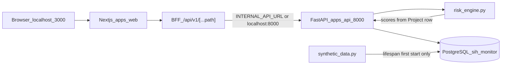
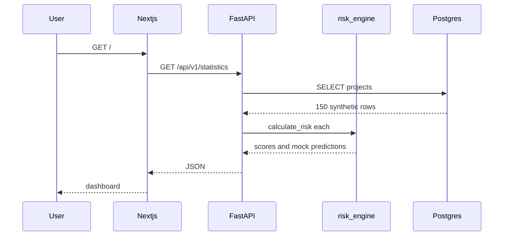
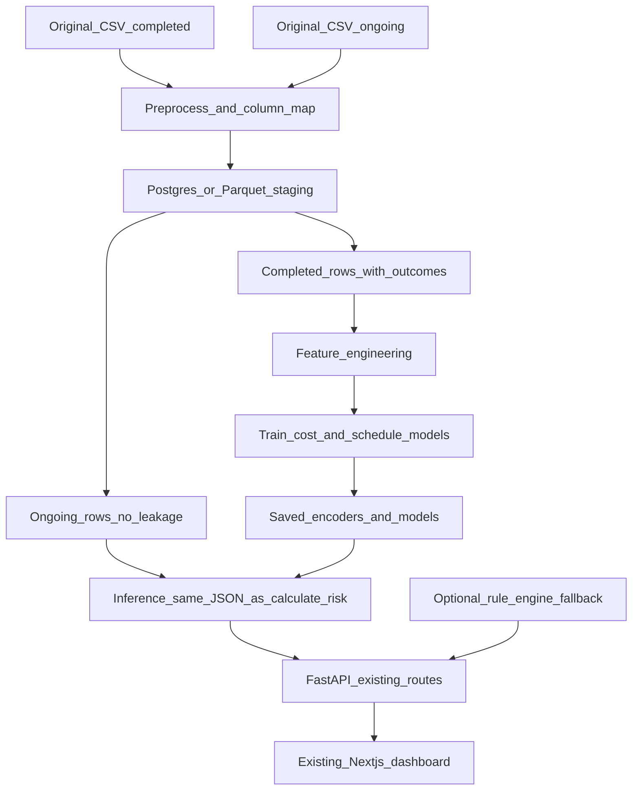

# PROJECT STATUS REPORT

**Repository:** SIH Predictive Infrastructure Monitoring (PAIMANA / OCMS decision-support MVP)  
**Report date:** 2 September 2026  
**Scope:** Read-only inspection of the current repository. No application code, models, or existing files were modified to produce this document.  
**Method:** File contents were read directly. Filenames were not treated as proof that a capability exists.

---

## Component status (summary)

| Component | Status | Uses Dummy Data? | Ready for Real Data? | Main Issue |
| --- | --- | --- | --- | --- |
| Frontend dashboard | COMPLETE (MVP) | Yes (via API) | Partial | Charts/tables work; some copy is hardcoded; no ingest UX |
| FastAPI monitoring API | COMPLETE (MVP) | Yes | Partial | Endpoints work; several routes always label data as synthetic |
| Risk engine | COMPLETE (rules) | No (calculates from stored fields) | Partial | Explainable formulas, not a trained model |
| Cost “prediction” | MOCK | Yes (heuristic on stored costs) | No | `estimated_cost_overrun` is realized cost growth, not a forecast |
| Schedule / delay “prediction” | MOCK | Yes (heuristic on scores) | No | `delay_probability` is a clamped formula, not a trained probability |
| ML training / serving | NOT IMPLEMENTED | N/A | No | No scripts, libraries, notebooks, or saved artifacts |
| CSV / data pipeline | NOT IMPLEMENTED | N/A | No | Zero CSV/JSON dataset files; no ingestion code |
| PostgreSQL storage | PARTIAL | Yes (seeded on first start) | Partial | Single `projects` table; no predictions/alerts/features tables |
| Docs vs implemented code | PARTIAL | N/A | N/A | Phase docs still describe a foundation-only repo |
| Docker Compose (web / api / db) | COMPLETE | N/A | Yes | Production-style containers for the current MVP |

---

## 1. PROJECT OVERVIEW

### What the project currently does

The repository is a working **SIH MVP** titled “AI-Powered Predictive Infrastructure Monitoring & Early Warning System.” It is a **decision-support layer**, not a replacement for PAIMANA/OCMS.

As implemented today it:

1. Seeds PostgreSQL with **150 fictional infrastructure projects** on first API startup (`apps/api/app/services/synthetic_data.py`).
2. Scores each project with a **transparent, calculation-based risk engine** (`apps/api/app/services/risk_engine.py`).
3. Exposes those scores through FastAPI (`/api/v1/projects`, `/risk/portfolio`, `/statistics`, etc.).
4. Renders a Next.js command-center dashboard (portfolio + project drill-down) that proxies API calls through same-origin `/api/v1/*`.

The README states the portfolio is **Synthetic Demonstration Data** and that the engine “makes no trained ML or accuracy claim.”

### Main objective / problem being solved

The intended problem (README, `apps/api/app/main.py`, `docs/architecture.md`): consume PAIMANA-compatible project, financial, progress, and timeline data to **flag cost overruns, schedule delays, and implementation risk early**, so ministries/agencies can intervene before failure.

The implemented problem: **demo a judge-flow dashboard** on synthetic projects, especially `SYN-DEMO-001` (“Demo National Transport Corridor”), with reproducible scores **84/100**, components **87 / 81 / 73**, trajectory **42 → 51 → 63 → 74 → 84**, and a HIGH rapid-escalation warning (`README.md`, `tests/unit/api/test_risk_engine.py`).

### Current implementation status

| Layer | Status |
| --- | --- |
| App shell, Docker, health probes, Alembic, pytest, ESLint | Implemented |
| Synthetic seed + Postgres `projects` table | Implemented |
| Rule-based risk, alerts, drivers, trajectory | Implemented |
| Portfolio and project dashboards (ECharts) | Implemented |
| PAIMANA ingestion, CSV loaders, feature store | Not implemented |
| Trained cost / schedule / risk models | Not implemented |
| Persistence of scores/alerts as separate tables | Not implemented |

`docs/development-phases.md` still marks **Phase 1: Foundation** as current and lists dashboard, risk scoring, and ML as later phases. The code has already implemented a **Phase 5/6-style prototype** (rules + UI) **without** Phases 2–4 (real data, features, models).

### Complete vs incomplete

**Complete for the synthetic MVP**

- Native and Docker run paths (`README.md`, `start_project.ps1`, `docker-compose.yml`).
- FastAPI app factory, CORS, health, monitoring routes.
- Next.js portfolio page, project page, BFF proxy, ECharts.
- Deterministic 150-row seed and unit test for the demo corridor.
- Single-table schema via Alembic revisions `001` and `002`.

**Incomplete relative to the stated product**

- No original/real CSV datasets in the repo.
- No `ml/`, `data/`, or `pipelines/` trees (docs describe them; disk does not contain them).
- No sklearn/XGBoost/LightGBM/MLflow/SHAP in `apps/api/requirements.txt`.
- Cost and delay “predictions” are aliases of rule outputs.
- No CRUD/ingest endpoints to load real projects.
- Seed never overwrites an existing portfolio (`if existing: return`).

---

## 2. COMPLETE PROJECT ARCHITECTURE



### Frontend

- **App:** Next.js 16.3.3, React 19, TypeScript, Tailwind CSS 4 (`apps/web/package.json`).
- **Pages:** `/` portfolio command center; `/projects/[projectId]` drill-down.
- **Charts:** Apache ECharts 6, SVG renderer (`apps/web/src/components/echart.tsx`).
- **Access pattern:** browser never talks to Postgres. Client `fetch`es `/api/v1/...`; Next.js route handlers forward to FastAPI (`apps/web/src/app/api/v1/[...path]/route.ts`).

### Backend

- **App:** FastAPI, Python 3.11+, Uvicorn, Pydantic Settings (`apps/api/requirements.txt`, `apps/api/app/main.py`).
- **ORM:** SQLAlchemy 2 async + asyncpg.
- **Migrations:** Alembic (`apps/api/alembic/`).
- **Services:** `synthetic_data.py` (seed), `risk_engine.py` (scoring). No ingestion or ML service modules.

### ML / AI components

- **Implemented:** none as models. The risk engine docstring says it “deliberately uses explainable, calculation-based indicators rather than claiming an ML model” and that its JSON contract is the replacement boundary for a future XGBoost/LightGBM/statistical model (`apps/api/app/services/risk_engine.py` lines 1–6, README “Scope boundary”).
- **Planned only:** `docs/architecture.md` lists `ml/features/`, `ml/models/{cost,schedule,risk}/`, `ml/evaluation/`, `ml/explainability/`. Those directories **do not exist**.

### Database / storage

- PostgreSQL 16 (`postgres:16-alpine` in `docker-compose.yml`).
- Database name default `sih_monitor` (`.env.example`).
- Docker host port default **5433** to avoid clashing with local 5432.
- One operational table: `projects`.
- Docs also plan Parquet under `data/raw|processed|features` and Polars/DuckDB (`docs/data-architecture.md`). Those folders and libraries are **not present**.

### APIs

Versioned under `/api/v1`. Root probes: `/health/live`, `/health/ready`. Swagger at `/docs`. Frontend health: `GET /api/health` (Next.js) → FastAPI `/api/v1/health`.

### Data pipeline

**Current:** Python generator → SQLAlchemy insert → Postgres.  
**Planned:** PAIMANA → `pipelines/ingestion/` → Parquet → transform → features → train/infer (`docs/data-architecture.md`). **Not implemented.**

### Dashboard / visualization

Implemented in `apps/web/src/app/page.tsx` and `apps/web/src/app/projects/[projectId]/page.tsx`. Values come from API JSON except a few hardcoded UI strings (see §12).

### How components communicate

1. `create_app` lifespan calls `seed_synthetic_projects` (`apps/api/app/main.py`).
2. Dashboard loads `/api/v1/statistics`, `/api/v1/risk/portfolio`, `/api/v1/projects` (home) or `/api/v1/projects/{id}` (detail).
3. Next.js BFF concatenates path + query and `fetch`es FastAPI with `cache: "no-store"`.
4. Project routes load all `Project` rows, run `calculate_risk` in process, return JSON. Scores are **not stored**.

### End-to-end workflow (intended vs actual)

**Intended (docs):** PAIMANA CSV/API → ingest → features → trained models → scores/alerts tables → dashboard.

**Actual:** empty DB → seed 150 synthetic rows → on each request recompute formulas → JSON → ECharts/table.

---

## 3. DIRECTORY / FILE STRUCTURE

Important paths only. `node_modules/`, `.next/`, `venv/`, and caches are build artifacts, not product source.

```
SIH project/
├── README.md
├── .env.example
├── docker-compose.yml
├── setup_db.py
├── start_project.ps1
├── pytest.ini
├── docs/
│   ├── architecture.md
│   ├── data-architecture.md
│   └── development-phases.md
├── apps/
│   ├── api/                 # FastAPI
│   └── web/                 # Next.js
└── tests/
    ├── unit/api/
    └── integration/
```

### Root

| File | Purpose |
| --- | --- |
| `README.md` | How to run, health/MVP endpoints, synthetic-data disclaimer |
| `.env.example` | Postgres/API/frontend env template (not secrets) |
| `docker-compose.yml` | Services `web`, `api`, `db` |
| `setup_db.py` | Create local Postgres role/database from `POSTGRES_ADMIN_URL` |
| `start_project.ps1` | Native Uvicorn `--reload` + `npm run dev` |
| `pytest.ini` | Unit tests default to `tests/unit`; `apps/api` on `pythonpath` |
| `.gitignore` | Ignores `.env`, venv, `.next`, future `*.pkl`/`*.parquet`/`data/*` |

### Backend entry points

| File | Role |
| --- | --- |
| `apps/api/app/main.py` | **API entry:** `app = create_app()`; lifespan seed |
| `apps/api/Dockerfile` | `alembic upgrade head && uvicorn app.main:app` |
| `apps/api/app/api/v1/router.py` | Mounts health + projects routers |
| `apps/api/app/api/v1/endpoints/projects.py` | Monitoring endpoints |
| `apps/api/app/api/v1/endpoints/health.py` | Live/ready + `/api/v1/health` |
| `apps/api/app/services/risk_engine.py` | Scoring |
| `apps/api/app/services/synthetic_data.py` | Seed + `demo_project()` |
| `apps/api/app/models/project.py` | ORM |
| `apps/api/app/core/config.py` | Settings from repo-root `.env` |
| `apps/api/app/db/session.py` | Async engine |
| `apps/api/alembic/env.py` | Async migrations |
| `apps/api/alembic/versions/001_initial_schema.py` | `projects` core columns |
| `apps/api/alembic/versions/002_synthetic_monitoring_fields.py` | Monitoring columns |

### Frontend entry points

| File | Role |
| --- | --- |
| `apps/web/src/app/layout.tsx` | Root layout / metadata |
| `apps/web/src/app/page.tsx` | **UI entry:** portfolio dashboard |
| `apps/web/src/app/projects/[projectId]/page.tsx` | Project detail |
| `apps/web/src/app/api/v1/[...path]/route.ts` | BFF proxy (GET only) |
| `apps/web/src/app/api/health/route.ts` | Proxied health |
| `apps/web/src/lib/types.ts` | TypeScript contracts |
| `apps/web/src/components/dashboard-shell.tsx` | Shell, badges, `formatCrore` |
| `apps/web/next.config.ts` | `output: "standalone"` |
| `apps/web/Dockerfile` | Multi-stage Node 22 image |

### ML entry points

**None.** No `ml/` package, no training script, no `model.py`.

### Tests

| File | Role |
| --- | --- |
| `tests/unit/api/test_risk_engine.py` | Locks demo corridor scores/alerts |
| `tests/unit/api/test_health.py` | Health contracts with mocked DB |
| `tests/unit/api/conftest.py` | Mock sessions for unit tests |
| `tests/integration/test_database_connection.py` | Live Postgres identity check |

### Planned but missing on disk

`ml/`, `pipelines/`, `data/raw`, `data/processed`, `data/features`, `data/samples` — described in docs / `.gitignore`, **not present** (no `.gitkeep` either).

---

## 4. DATASETS

### Finding: no CSV or JSON dataset files

A repository-wide search for `*.csv` returned **0 files**. No application JSON datasets, Excel files, SQLite files, Parquet files, or notebooks (`*.ipynb`) were found. There is therefore **nothing to profile as a tabular file** (no row/column counts from disk).

The only dataset is **generated in Python and stored in PostgreSQL**.

---

### Dataset A — In-code synthetic generator (not a file)

| Attribute | Value |
| --- | --- |
| File name | `apps/api/app/services/synthetic_data.py` (generator, not a table dump) |
| Number of rows | **150** projects: 1 `demo_project()` + 149 `_project(index)` for `index in range(149)` |
| Number of columns | Matches `Project` ORM (~20 persisted fields + timestamps/UUID) |
| Classification | **Synthetic demonstration data** (deterministic `random.Random(20260826)`) |
| Missing values | Generator always fills required fields; `description` is a fixed string |
| Duplicate records | IDs `SYN-DEMO-001` and `SYN-001`…`SYN-149` are unique by construction |
| Target/label fields | No ML target. `condition` is a **generation scenario** (`ON_TRACK`, `COST_RISK`, `SCHEDULE_RISK`, `HIGH_RISK`, `RECOVERY`), not used by `calculate_risk` |
| Date/time | `planned_completion`, `expected_completion` as `date`; `risk_history[].month` as month abbreviations starting 1 Mar 2026 |

**Column inventory (generated / stored)**

| Column | Type (ORM) | Example (demo row) | Role |
| --- | --- | --- | --- |
| `id` | UUID | generated | PK |
| `name` | str | `Demo National Transport Corridor` | identifier |
| `description` | str \| null | synthetic description | optional text |
| `paimana_project_id` | str | `SYN-DEMO-001` | external ID |
| `status` | str | `active` | categorical |
| `ministry` | str | `Ministry of Road Transport & Highways` | categorical |
| `sector` | str | `Roads & Highways` | categorical |
| `agency` | str | `National Highways Authority of India` | categorical |
| `location` | str | `Maharashtra–Karnataka Corridor` | categorical |
| `approved_cost` | Numeric(16,2) | `28500.00` | numerical |
| `revised_cost` | Numeric(16,2) | `33117.00` | numerical |
| `expenditure` | Numeric(16,2) | `25500.00` | numerical |
| `planned_progress` | float | `80.0` | numerical (%) |
| `physical_progress` | float | `52.6` | numerical (%) |
| `planned_completion` | date | `2025-12-31` | temporal |
| `expected_completion` | date | `2026-08-02` | temporal |
| `condition` | str | `HIGH_RISK` | categorical (seed only) |
| `risk_history` | JSON | `[{month:"Mar", risk:42}, … {month:"Jul", risk:84}]` | pre-baked scores |
| `is_synthetic` | bool | `true` | flag |
| `created_at` / `updated_at` | timestamptz | DB default | temporal |

**Categorical fields:** `status`, `ministry`, `sector`, `agency`, `location`, `condition`, `is_synthetic`. Ministries/sectors come from the `MINISTRIES` tuple; locations from `LOCATIONS`; names from `PROJECT_WORDS`.

**Numerical fields:** costs, progress percentages, and JSON `risk` integers 5–98.

**Quality issues**

- `risk_history` is **not observed risk**; it is authored to match a scenario so the UI shows a rising/falling line.
- Cost units are unlabeled in the DB; the UI always appends **₹ … Cr** (`formatCrore`).
- `condition` can disagree with engine `risk_level` because the engine ignores `condition`.
- Seed is one-shot: any existing row blocks reseeding.

---

### Dataset B — PostgreSQL table `projects`

| Attribute | Value |
| --- | --- |
| File name | N/A (database `sih_monitor`, table `projects`) |
| Rows | 150 after first successful seed; 0 before seed |
| Schema | Alembic `001` + `002`; see §14 |
| Classification | **Synthetic seed in an operational store**, not real-world PAIMANA extracts |

If the API has never started against a given volume, this table can be empty. The report cannot inspect a live DB from files alone.

---

### Dataset C — Planned sample CSVs (`data/samples/`)

**NOT IMPLEMENTED.** Documented in `docs/data-architecture.md` only.

---

## 5. CURRENT FEATURE SCHEMA

The **only implemented pipeline** is `calculate_risk(project: Project)` in `apps/api/app/services/risk_engine.py`. Features below are what that function **reads or derives**. There is no sklearn `ColumnTransformer` or feature store.

### Project identifiers

| Feature | Source |
| --- | --- |
| `paimana_project_id` | DB (API as `project_id`) |
| `name` | DB (API as `project_name`) |
| `ministry`, `sector`, `agency`, `location` | DB (display / filters, **not used in scoring**) |
| `status` | DB (not used in scoring) |

### Temporal features

| Feature | Source |
| --- | --- |
| `planned_completion` | DB date |
| `expected_completion` | DB date |
| `milestone_delay` / `schedule_variance` | derived: `max((expected - planned).days, 0)` |
| `risk_history[].month` | JSON (display + velocity) |

### Categorical features

| Feature | Used by engine? |
| --- | --- |
| `condition` | No |
| `risk_trend` | **Derived** from history velocity (`STABLE` / `IMPROVING` / `WORSENING` / `RAPIDLY WORSENING`) |
| `risk_level` | **Derived** from `overall_risk` |

### Numerical features (inputs)

| Feature | Source |
| --- | --- |
| `approved_cost` | DB |
| `revised_cost` | DB |
| `expenditure` | DB |
| `planned_progress` | DB |
| `physical_progress` | DB |
| `risk_history[].risk` | JSON integers |

### Derived / calculated features (engine)

| Feature | Formula (from code) |
| --- | --- |
| `cost_growth` | `((revised - approved) / approved) * 100` |
| `progress_variance` | `planned_progress - physical_progress` |
| `expenditure_ratio` | `(expenditure / revised_cost) * 100` |
| `expenditure_acceleration` | `max(expenditure_ratio - physical_progress, 0)` |
| `cost_risk` | `clamp(cost_growth * 3.56 + expenditure_acceleration * 1.2)` |
| `schedule_risk` | `clamp(milestone_delay / 4 + max(progress_variance, 0))` |
| `execution_risk` | `clamp(max(progress_variance, 0) * 2 + expenditure_acceleration * 0.76)` |
| `risk_velocity` | `scores[-1] - scores[-2]` |
| `risk_acceleration` | `velocity - previous_velocity` |
| `escalation_adjustment` | `min(5, max(0, velocity * 0.26))` |
| `overall_risk` | `clamp(0.40*cost + 0.35*schedule + 0.25*execution + escalation_adjustment)` |
| Drivers | integer contributions from slippage, variance, growth, acceleration |
| `estimated_cost_overrun` | `round(max(cost_growth, 0), 1)` |
| `delay_probability` | `min(99, round(schedule_risk * 0.75 + execution_risk * 0.30))` |

`clamp` rounds into `[0, 100]`.

### Target variables

**None in a supervised-learning sense.** The engine does not train. If future models were fit:

- Cost target analogue today: `cost_growth` (already known at scoring time — **not a future outcome**).
- Delay analogue: `milestone_delay` or the heuristic `delay_probability`.
- Risk analogue: `overall_risk` or `risk_history[-1]`, both **constructed**, not labels.

Using `risk_history` as a feature **and** as a target would leak the synthetic generator’s scenario.

---

## 6. MACHINE LEARNING STATUS

| Item | Status | Evidence |
| --- | --- | --- |
| Any model class / estimator | **NOT IMPLEMENTED** | No sklearn/xgboost/lightgbm imports in app code |
| Any model trained | **No** | No `.pkl`, `.joblib`, `.h5`, `.pt`, `.onnx`, `mlruns/` |
| Algorithms implemented | Rule-based scoring only | `risk_engine.py` |
| Algorithms planned | XGBoost, LightGBM, or statistical model; cost/schedule/risk heads; SHAP; MLflow | README scope boundary; `docs/development-phases.md` Phase 4; `docs/architecture.md` |
| Training scripts | **NOT IMPLEMENTED** | No `train.py` / notebooks |
| Prediction scripts | **MOCK** inside `calculate_risk` → `predictions` dict | `risk_engine.py` lines 156–162 |
| Feature engineering | **PARTIAL** (hand formulas) | same file |
| Preprocessing | **NOT IMPLEMENTED** | No imputers, encoders, scalers |
| Encoders / scalers | **NOT IMPLEMENTED** | — |
| Train/test split | **NOT IMPLEMENTED** | — |
| Validation strategy | **NOT IMPLEMENTED** | Unit test asserts **fixed demo numbers**, not CV |
| Target variables | **NOT DEFINED** for ML | — |
| Evaluation metrics | **NOT IMPLEMENTED** | No MAE/RMSE/AUC |
| Saved model files | **None** | `.gitignore` reserves `*.pkl` / `*.joblib` for the future |
| Dummy / mock prediction | **IMPLEMENTED** | `estimated_cost_overrun`, `delay_probability` |

**IMPLEMENTED vs PLANNED**

- **IMPLEMENTED:** deterministic feature math; risk components; alerts; JSON contract `features/scores/trajectory/drivers/alerts/predictions`.
- **PLANNED:** ingest real completed projects; train cost/schedule/risk models; evaluate; explain with SHAP; swap the body of `calculate_risk` while keeping the output shape.

Do not treat the filename `risk_engine.py` as a trained model. The module header and README deny that claim.

---

## 7. DUMMY DATA / MOCK LOGIC

### Where it is stored

1. **Source of truth for generation:** `apps/api/app/services/synthetic_data.py` (`MINISTRIES`, `LOCATIONS`, `PROJECT_WORDS`, `CONDITIONS`, `_history`, `_project`, `demo_project`).
2. **Operational store:** PostgreSQL `projects` after seed (`is_synthetic=true`).
3. **Pre-baked time series:** `risk_history` JSON on each row (especially the five-point demo series).

### Where it enters the system

`apps/api/app/main.py` lifespan:

```python
async with async_session_factory() as session:
    await seed_synthetic_projects(session)
```

`seed_synthetic_projects` counts rows; if count > 0 it returns without writing. First empty database gets `demo_project()` plus 149 generated rows.

### Which components depend on it

| Component | Dependency |
| --- | --- |
| All `/api/v1/projects*` and `/risk/portfolio` / `/statistics` | Read `projects` |
| `calculate_risk` | Needs populated numeric/date/JSON fields |
| Dashboard KPI cards, charts, table, detail page | API JSON from those rows |
| `test_demo_corridor_has_the_expected_explainable_warning_profile` | In-memory `demo_project()`, not DB |
| UI badge “Synthetic Demonstration Data” | Hardcoded on pages **and** `data_source` from API |

### Additional mock / hardcoded UI (not DB)

- Home header: `Updated Jul 2026 · Prototype` (`page.tsx`).
- Pulse label `LIVE MODEL INPUT` despite no live model (`page.tsx`).
- Detail page “Recommended investigation” is a **fixed four-item list** (`projects/[projectId]/page.tsx`).
- Nav links `#portfolio-table` / `#risk-lens` only work on the home page.

### Several API routes hardcode the synthetic label

`list_projects`, `get_project_risk`, `get_project_alerts`, `portfolio_risk`, and `statistics` set `"data_source": SYNTHETIC_LABEL` even if a future row had `is_synthetic=false`. Only `project_payload` (used by `GET /projects/{id}`) chooses the label from `project.is_synthetic` (`risk_engine.py`).

### What would need to change to use original CSV data

1. Add CSV files (they are not in the repo today).
2. Map columns onto `Project` fields (or a staging schema).
3. Write an ingest path that inserts/updates rows **without** relying on empty-DB seed.
4. Build real `risk_history` from period snapshots, or stop using synthetic history for velocity.
5. Stop hardcoding `SYNTHETIC_LABEL` on aggregate endpoints.
6. Retrain is N/A until models exist; the **rule engine can run immediately** if required numeric/date fields are present.
7. Replace heuristic `predictions` if true forecasts are required.

---

## 8. ORIGINAL DATA READINESS

No original CSV was found, so this section describes **what the current architecture expects**, not a measured mapping of a real file.

### Required columns (engine will crash or be meaningless without them)

Must be present and valid on each `Project`:

- `approved_cost` ≠ 0 (division in `cost_growth`)
- `revised_cost` ≠ 0 (division in `expenditure_ratio`)
- `expenditure`
- `planned_progress`, `physical_progress`
- `planned_completion`, `expected_completion` (Python `date`)
- `risk_history`: list of `{month, risk}` with at least one `risk` (velocity needs ≥2 points for trends)

ORM also requires `name`, `paimana_project_id`, `ministry`, `sector`, `agency`, `location`, `condition` as non-null (`apps/api/app/models/project.py`). Alembic `002` added those monitoring columns as **nullable=True**, so a DB filled outside the ORM could contain NULLs that the engine cannot handle.

### Optional columns

- `description`
- `status` (defaults `active`; unused by engine)
- `is_synthetic` (defaults true in migration)
- `condition` (required by ORM, unused by engine)

### Columns that can be derived

`cost_growth`, `progress_variance`, `milestone_delay`, `expenditure_ratio`, `expenditure_acceleration`, all risk scores, drivers, alerts, heuristic predictions.

`risk_history` **cannot** be honestly derived from a single snapshot; it needs a time series of past scores or raw period metrics.

### Columns that may be missing in real PAIMANA extracts

Typical gaps vs this schema (inferred from docs, not from a file):

- `revised_cost` vs only sanctioned/approved cost
- `planned_progress` vs only physical progress
- `expected_completion` vs slip days
- Monthly risk scores (this app invents them)
- Ministry/sector/agency naming consistent with filters

### Potential naming mismatches

Internal names are English snake_case (`paimana_project_id`, `physical_progress`). Real dumps may use Hindi/English headers, PAIMANA codes, or different spellings (`phy_progress`, `sanctioned_cost`, `RCE`, etc.). **No mapping table exists in code.**

### Unit mismatches

UI assumes **crore INR**. If CSV is in lakh, rupees, or USD, KPIs and `formatCrore` will be wrong. Engine ratios are unit-agnostic if approved/revised/expenditure share a unit.

Progress is treated as **percentage points** (0–100 scale). A 0–1 fraction would inflate `progress_variance` and scores.

### Date-format mismatches

Engine uses `datetime.date` subtraction. Ingest must parse to dates. `risk_history.month` is display text (`Mar`), not ISO dates — averaging by month string in `portfolio_risk` can mis-order or collide years.

### Categorical-value mismatches

API query filters expect:

- `risk_level`: `LOW|MEDIUM|HIGH|CRITICAL`
- `trend`: `STABLE|IMPROVING|WORSENING|RAPIDLY WORSENING`

These are **computed**, not ingested. Ingested categoricals (`ministry`, `sector`) are free strings; the UI builds filter options from distinct values.

### Data leakage risks

1. **`risk_history` as both input and implied label** — history is generated from the same `condition`/`final_score` as the story the demo tells.
2. **`estimated_cost_overrun` = current `cost_growth`** — using revised cost to “predict” overrun is looking at an outcome already in the features.
3. **`delay_probability` uses current delay and progress gap** — contemporaneous with the “label.”
4. Training on `overall_risk` as a target would fit the **hand-tuned weights**, not real failures.

### Schema conflicts: completed vs ongoing

The repo does **not** distinguish completed vs ongoing datasets. One `status` string exists (`active`). There is no `actual_completion`, `final_cost`, `delay_days_outcome`, or `overrun_flag` for supervised learning on finished projects. Completed and ongoing rows would currently share the same snapshot schema — a conflict for honest train/test design.

---

## 9. COST PREDICTION PIPELINE

### Intended (docs)

Input completed-project financials → features (budget variance, expenditure rate) → trained cost-overrun model (`ml/models/cost/`) → predicted overrun / probability → dashboard.

### Current (code)

```
Input: Project.approved_cost, revised_cost, expenditure, physical_progress
    → cost_growth, expenditure_ratio, expenditure_acceleration
    → cost_risk = clamp(cost_growth * 3.56 + expenditure_acceleration * 1.2)
    → alerts if cost_growth >= 10
    → predictions.estimated_cost_overrun = round(max(cost_growth, 0), 1)
Output: cost_risk (0–100) and a percentage equal to current growth
```

Demo corridor check: `(33117 - 28500) / 28500 * 100 ≈ 16.2%` growth; unit test expects `cost_risk == 87`.

### Implemented vs missing

| Step | Status |
| --- | --- |
| Input fields on `Project` | Implemented (synthetic) |
| Preprocessing / units / missing values | Missing |
| Feature engineering (growth, spend vs progress) | Implemented (formulas) |
| Trained model | Missing |
| True forecast of *future* overrun | Missing (uses already-revised cost) |
| Output on API and UI (“Estimated overrun”) | Implemented as mock |

---

## 10. SCHEDULE / DELAY PREDICTION PIPELINE

### Intended (docs)

Input timelines and milestones → schedule features → trained delay model (`ml/models/schedule/`) → delay probability / expected slip → dashboard.

### Current (code)

```
Input: planned_completion, expected_completion, planned_progress, physical_progress
     + expenditure_acceleration (also used in execution_risk)
    → milestone_delay = max((expected - planned).days, 0)
    → progress_variance = planned_progress - physical_progress
    → schedule_risk = clamp(milestone_delay / 4 + max(progress_variance, 0))
    → execution_risk = clamp(max(progress_variance, 0) * 2 + expenditure_acceleration * 0.76)
    → alert if milestone_delay >= 90
    → delay_probability = min(99, round(schedule_risk * 0.75 + execution_risk * 0.30))
Output: schedule_risk, execution_risk, delay_probability (0–99 integer)
```

Demo corridor: 214 days from 2025-12-31 to 2026-08-02; unit test `schedule_risk == 81`, `execution_risk == 73`. Heuristic delay probability ≈ `round(81*0.75 + 73*0.30) = 83` (not asserted in tests).

### Implemented vs missing

| Step | Status |
| --- | --- |
| Date and progress inputs | Implemented (synthetic) |
| Delay days and progress gap | Implemented |
| Calibrated probability / survival / remaining-duration model | Missing |
| Train/test on completed projects’ actual delay | Missing |
| UI display of “Delay probability” | Implemented as mock |

---

## 11. RISK DETECTION / MONITORING LOGIC

Risk is **100% rule-based**. No ML classifier.

### Component scores

See formulas in §5. Weights for overall:

- 40% cost, 35% schedule, 25% execution, plus up to +5 from velocity.

### Severity bands (`_severity`)

| Score | Level |
| --- | --- |
| ≥ 80 | CRITICAL |
| ≥ 65 | HIGH |
| ≥ 40 | MEDIUM | 
| else | LOW |

### Trend (`risk_history`)

Let `velocity = last - previous`, `recent_change = last - scores[-3]`.

| Condition | Trend |
| --- | --- |
| `velocity >= 8` or `recent_change >= 16` | RAPIDLY WORSENING |
| `velocity >= 3` | WORSENING |
| `velocity <= -3` | IMPROVING |
| else | STABLE |

### Alerts (thresholds)

| Type | Trigger |
| --- | --- |
| COST OVERRUN WARNING | `cost_growth >= 10` |
| SCHEDULE DELAY WARNING | `milestone_delay >= 90` |
| EXECUTION RISK WARNING | `execution_risk >= 55` |
| RAPID RISK ESCALATION | trend is RAPIDLY WORSENING; severity HIGH unless `overall_risk >= 90` then CRITICAL |

Alerts are sorted so RAPID RISK ESCALATION is first.

### Drivers

Integer “contributions” (not SHAP):

- Schedule Slippage: `(milestone_delay + 9) // 10`
- Progress Variance: `round(max(progress_variance, 0) * 0.7)`
- Cost Growth: `round(max(cost_growth, 0))`
- Expenditure Acceleration: `round(expenditure_acceleration * 0.44)`

Zero-contribution drivers are dropped; top 4 kept.

### Dashboard-level risk

- Portfolio distribution: counts of `risk_level`.
- Portfolio trend: **mean** of `risk_history` points grouped by month string.
- Ministry/sector comparison: mean `overall_risk`.
- Top intervention queue: top 10 by `overall_risk`.
- Statistics: counts of HIGH, CRITICAL, and trends in `{WORSENING, RAPIDLY WORSENING}`.

**Note:** `high_risk_projects` counts **only** `risk_level == "HIGH"`, not CRITICAL (`projects.py` statistics). Critical projects are a separate card.

### Persistence

Scores/alerts are **not written back** to Postgres. Refreshing recomputes from the same row.

---

## 12. DASHBOARD / UI STATUS

### Pages / screens

| Route | File | Role |
| --- | --- | --- |
| `/` | `apps/web/src/app/page.tsx` | Portfolio command center |
| `/projects/[projectId]` | `apps/web/src/app/projects/[projectId]/page.tsx` | Project risk profile |
| Layout / sidebar | `dashboard-shell.tsx` | PAIMANA branding, nav |

No auth, no settings, no ingest UI. Sidebar “Early Warnings” is an anchor to the home table, not a separate page.

### Home metrics (from `GET /statistics` unless noted)

| Card | Source | Real / dummy / hardcoded |
| --- | --- | --- |
| Total projects | API | Calculated on synthetic rows |
| High risk | API | Calculated (HIGH only) |
| Critical | API | Calculated |
| Rising risk | API | Calculated |
| Approved cost | API + `formatCrore` | Synthetic numbers, formatted as ₹ Cr |
| Potential exposure | `sum(max(revised-approved,0))` | Calculated from synthetic costs |
| “Updated Jul 2026” | JSX string | **Hardcoded** |
| Synthetic badge | JSX | **Hardcoded** (also matches API) |

### Charts (home)

| Chart | Data | Kind |
| --- | --- | --- |
| Risk distribution | `portfolio.risk_distribution` | Pie |
| Portfolio risk trajectory | `portfolio.portfolio_trend` | Line |
| Ministry comparison | `portfolio.ministry_comparison` | Bar |
| Sector comparison | `portfolio.sector_comparison` | Bar |

All calculated from synthetic DB + engine. Label `LIVE MODEL INPUT` is **hardcoded** and misleading.

### Tables / filters / views

- **Top intervention queue:** first 5 of `top_risky_projects` (API returns 10).
- **Project risk register:** all projects fetched once (`GET /projects` **without** query params). Client filters: ministry, sector, risk level, trend.
- API also supports those query params, but the UI does not send them.

### Project view outputs

| Item | Source | Kind |
| --- | --- | --- |
| Overall risk /100 | `risk.scores.overall_risk` | Calculated |
| Cost / schedule / execution metrics | scores + features | Calculated |
| Trajectory chart | `risk_history` | **Synthetic series** |
| Velocity / acceleration | engine | Calculated from that series |
| Delay probability / estimated overrun | `risk.predictions` | **Mock formulas** |
| Drivers / early warnings | engine | Calculated |
| Recommended investigation | static array of 4 strings | **Hardcoded** |
| Approved / revised / spent | project costs + `formatCrore` | Synthetic, formatted as Cr |

### Prediction outputs on UI

Displayed, but they are **not model outputs** (see §9–10).

---

## 13. API / BACKEND STATUS

Unless noted, “works” means the route is implemented and wired; it depends on Postgres + seed for non-health paths. Unit tests cover health and the demo engine, **not** HTTP contracts for project routes.

### Health

| Endpoint | Purpose | Input | Output | Data source | Works? | Dummy? |
| --- | --- | --- | --- | --- | --- | --- |
| `GET /health/live` | Process alive | none | `{status, service, version}` | none | Yes (tested) | No |
| `GET /health/ready` | DB ping | none | health + `dependencies.database` | `SELECT 1` | Yes (tested) | No |
| `GET /api/v1/health` | App health | none | same shape as ready | `SELECT 1` | Yes (tested) | No |
| `GET /docs`, `/redoc` | OpenAPI | — | Swagger/ReDoc | FastAPI | Yes | N/A |

### Monitoring

| Endpoint | Purpose | Input | Output | Data source | Works? | Dummy? |
| --- | --- | --- | --- | --- | --- | --- |
| `GET /api/v1/projects` | Risk register | query: `ministry`, `sector`, `risk_level`, `trend` | `{data_source, total, projects[]}` each with `risk` | all `Project` rows + engine | Implemented | Yes; `data_source` always synthetic label |
| `GET /api/v1/projects/{id}` | Detail | path `paimana_project_id` | `project_payload` | one row + engine | Implemented; 404 if missing | Yes if seeded; label follows `is_synthetic` |
| `GET /api/v1/projects/{id}/risk` | Engine dump | path id | features, scores, trajectory, drivers, alerts, predictions | one row | Implemented | Yes; hardcoded synthetic label |
| `GET /api/v1/projects/{id}/alerts` | Warnings only | path id | `{alerts}` | engine | Implemented | Yes |
| `GET /api/v1/risk/portfolio` | Charts + top 10 | none | distribution, trend, ministry/sector averages, top_risky_projects | all rows | Implemented | Yes |
| `GET /api/v1/statistics` | KPI cards | none | counts and cost sums | all rows | Implemented | Yes |

No POST/PUT/PATCH/DELETE project APIs. No model inference endpoint separate from `calculate_risk`.

### Frontend BFF

| Endpoint | Purpose | Input | Output | Data source | Works? | Dummy? |
| --- | --- | --- | --- | --- | --- | --- |
| `GET /api/v1/*` (Next) | Proxy | path + search | FastAPI JSON or 503 | FastAPI | GET only | Same as backend |
| `GET /api/health` | Proxy health | none | FastAPI health or 503 | FastAPI | Yes | No |

BFF does not implement POST. `StandardResponse` in `apps/api/app/schemas/common.py` is **unused** by project routes (plain dicts). Errors use `ErrorResponse` in exception handlers (`main.py`).

---

## 14. DATABASE / STORAGE STATUS

### Technology

PostgreSQL 16, async SQLAlchemy, asyncpg, Alembic. Docker volume `postgres_data`. Native setup via `setup_db.py`.

### Tables / collections

Only **`projects`**. Docs mention future `risk_scores`, `predictions`, `early_warnings`, `features` — **not created**.

### Schema (union of migrations + ORM)

| Column | Migration | ORM notes |
| --- | --- | --- |
| `id` | UUID PK `gen_random_uuid()` | UUID mixin |
| `name` | VARCHAR(255) NOT NULL | required |
| `description` | TEXT NULL | optional |
| `paimana_project_id` | VARCHAR(100) UNIQUE | required, indexed |
| `status` | VARCHAR(50) default `active` | indexed |
| `created_at` / `updated_at` | timestamptz default now() | mixin |
| `ministry` … `risk_history` | added in `002` as **nullable** | ORM **non-null** |
| `is_synthetic` | BOOLEAN default true NOT NULL | required |

Indexes: `paimana_project_id`, `status`, `ministry`, `sector`.

### Seed / mock data

`seed_synthetic_projects` inserts 150 rows when `COUNT(*) == 0`. No SQL dump file. No CSV copy.

### Files used for storage

None for application data. Config is `.env` (gitignored). Compose named volume for Postgres files.

### Data flow into the application

```
First API start → seed → projects
Later requests → SELECT * FROM projects ORDER BY name → calculate_risk per row
```

There is no file watcher, no PAIMANA connector, no COPY FROM CSV.

---

## 15. DEPENDENCIES AND TECHNOLOGY STACK

### Runtimes

- Python ≥ 3.11 (`apps/api/pyproject.toml`)
- Node.js ≥ 22 (`apps/web/package.json`)
- PostgreSQL 16

### Backend (`apps/api/requirements.txt`)

fastapi, uvicorn[standard], sqlalchemy[asyncio], asyncpg, pydantic, pydantic-settings, alembic, python-dotenv; pytest, pytest-asyncio, httpx; ruff, black.

**Not installed:** numpy/pandas/polars, scikit-learn, xgboost, lightgbm, shap, mlflow, duckdb.

### Frontend (`apps/web/package.json`)

next 16.3.3, react 19.2.8, echarts 6.1.0; Tailwind 4, ESLint, Prettier, TypeScript.

**Not installed:** shadcn/ui (mentioned in Phase 6 docs).

### Infra / APIs

- Docker Compose: `web`, `api`, `db`
- External PAIMANA/OCMS API: **not integrated**
- OpenAPI via FastAPI `/docs`

---

## 16. CURRENT END-TO-END WORKFLOW

What actually runs today:

1. Operator copies `.env.example` → `.env`, creates DB (`setup_db.py` and/or Compose), runs `alembic upgrade head`.
2. Uvicorn starts `app.main:app`. Lifespan opens a session and seeds **if the table is empty**.
3. Next.js dev/prod server starts. Browser opens `http://localhost:3000`.
4. Home page `useEffect` fetches `/api/v1/statistics`, `/api/v1/risk/portfolio`, `/api/v1/projects` through the BFF.
5. FastAPI loads every `Project`, runs `calculate_risk`, aggregates, returns JSON labelled (mostly) as Synthetic Demonstration Data.
6. React state drives KPI cards, four ECharts, intervention list, and filterable table.
7. User opens `/projects/SYN-DEMO-001` (or any `paimana_project_id`). Detail fetch returns payload + risk. Charts/warnings render. Investigation bullets are static.
8. No write-back, no model file, no CSV. Stopping and restarting **does not reseed** if rows already exist.



---

## 17. GAPS AND PROBLEMS

1. **No original CSV / real portfolio in the repository** — cannot validate column maps or train.
2. **No ML stack** — docs over-promise Polars/DuckDB/MLflow/SHAP/XGBoost.
3. **Mock predictions** presented in UI as delay probability and estimated overrun.
4. **Circular `risk_history`** — generator writes the story the engine then “detects.”
5. **No ingest/CRUD** — cannot load CSV without new code.
6. **Seed is non-idempotent in the wrong way** — cannot refresh demo data if any row exists; also cannot mix real rows with a later seed.
7. **Hardcoded `SYNTHETIC_LABEL`** on aggregate endpoints.
8. **`high_risk_projects` omits CRITICAL** from the High-risk card.
9. **ORM vs migration nullability** mismatch on monitoring columns.
10. **`condition` unused** by scoring; can confuse future schema design.
11. **Frontend ignores API filter query params**; loads full portfolio every time (acceptable at 150, not at national scale).
12. **BFF GET-only**; no cache of computed risk.
13. **`StandardResponse` unused**; project APIs are ad-hoc dicts.
14. **Docs Phase 1 vs implemented dashboard** — onboarding risk.
15. **Missing `ml/`, `data/`, `pipelines/`** despite architecture docs.
16. **No completed-project outcome fields** — supervised learning blocked even after CSV arrives if files are snapshot-only.
17. **Month-string portfolio trend** can mis-aggregate across years.
18. **Cost unit assumed crore** in UI only.
19. **Misleading UI:** “LIVE MODEL INPUT”, delay %, PAIMANA branding while data is synthetic.
20. **Project HTTP routes lack automated tests** (only engine demo + health).
21. **Division by zero** if a real row has `approved_cost` or `revised_cost` of 0.
22. **No auth / tenancy / audit** (acceptable for demo, not for PAIMANA production).

---

## 18. WHAT MUST CHANGE TO USE ORIGINAL CSV DATA

### Can remain unchanged

- Next.js page structure, ECharts wiring, TypeScript `Risk` / `Project` shapes (if JSON contract is kept).
- FastAPI routing layout and health probes.
- Docker Compose topology.
- `calculate_risk` **as a temporary scorer** if CSV can fill the required fields (until models exist).
- Alembic `projects` table as the operational cache (possibly extended, not replaced).

### Needs preprocessing

- Parse dates; unify progress to 0–100; unify money to one unit; drop/flag incomplete rows; generate a real period history or leave history empty and change trend logic.
- Deduplicate on `paimana_project_id`.

### Needs column mapping

- New mapping module (does not exist): CSV headers → `Project` attributes.
- Stable ID strategy if PAIMANA IDs are missing.

### Needs feature engineering

- Replace synthetic `risk_history` with rolling scores from period snapshots **or** drop velocity until 3+ periods exist.
- For ML: outcomes on **completed** projects (`final_cost`, `actual_end_date`) that are not in the current schema.

### Needs to be retrained

- Nothing today (no model). After first training: serialize artifacts and load them inside the engine boundary.

### Needs to be rewritten

- `synthetic_data.py` seed as the **only** data source (keep for demo, gate behind env).
- Hardcoded `data_source` on list/portfolio/statistics.
- `predictions` block if product claims true forecasts.
- Optional: ingest CLI or `POST /api/v1/projects/import`.
- Docs phases to match reality.

### Needs testing

- Parser/mapping tests on a fixture CSV (once provided).
- Engine tests on a **real-shaped** row (zeros, inverted progress, missing history).
- HTTP tests for list filters and 404.
- Dashboard checks that mixed `is_synthetic` labels appear correctly.

---

## 19. RECOMMENDED FINAL ARCHITECTURE

Based **only** on this repo’s contracts (not a greenfield rewrite):



**Principles already implied by the code**

1. Keep `calculate_risk`’s **output keys** as the serving contract (README “replacement boundary”).
2. Store raw mapped projects in `projects` (extend columns for outcomes and `as_of` period).
3. Do **not** train on `risk_history` or `overall_risk` as labels.
4. Train on completed projects; score ongoing projects.
5. Persist inference optionally later (`risk_scores` table as docs planned); MVP can keep compute-on-read.
6. Use synthetic seed only when `API_ENV=demo` or table empty **and** no CSV configured.
7. Add `data/raw` / `data/processed` as `.gitignore` already expects, once CSVs exist.

---

## 20. PRIORITY ACTION PLAN

### P0 — must fix before ML training

1. Obtain and place original CSVs (completed vs ongoing if they exist). **Blocked: files are not in the repo.**
2. Freeze a **label definition** that is not the rule engine’s own output (e.g. final overrun %, actual delay days).
3. Ban `risk_history` / `overall_risk` / heuristic `delay_probability` as training targets.
4. Handle zero/null costs and missing dates before any fit.

### P1 — required for real-data integration

1. Column mapping + validation into `Project` (or a staging table).
2. Ingest path that does not depend on empty-DB seed.
3. Fix `data_source` labelling from `is_synthetic`.
4. Align ORM and Alembic nullability.
5. Persist or compute honest multi-period history from CSV snapshots.
6. Document and convert units (₹ Cr vs source units).

### P2 — required for model training / validation

1. Add ML dependencies and a training script under a new `ml/` tree (as docs already describe).
2. Time-aware split (project-level, no leakage).
3. Metrics appropriate to regression vs classification.
4. Serialize encoders/models; load behind `calculate_risk`.
5. Keep the current formulas as fallback when a model is missing.

### P3 — dashboard / final integration / polish

1. Remove or reword “LIVE MODEL INPUT” and hardcoded investigation text.
2. Use API query filters or pagination.
3. Decide High-risk KPI definition (include CRITICAL or not).
4. Update `docs/development-phases.md` to match implemented MVP.
5. Add API tests for project routes; optional auth later.
6. Import UX or batch job status on the UI.

---

## 21. FINAL EXECUTIVE SUMMARY

### Current project maturity

**Working synthetic MVP / prototype.** Stronger than a folder of placeholders: Docker, API, Postgres, tests for health + demo scores, and a polished dashboard. **Weaker than an ML product:** no datasets on disk, no trained models, predictions are formulas.

Roughly: **product demo ~70% for SIH judging; real-data ML ~10%.**

### What is actually working

- End-to-end synthetic monitoring: seed → score → REST → UI.
- Explainable risk components, alerts, drivers, trajectory for `SYN-DEMO-001` locked by unit test (87 / 81 / 73 / 84, 42→84, RAPIDLY WORSENING).
- Health probes distinguishing live vs DB-ready.
- Same-origin BFF so the browser never needs the Docker-internal API hostname.

### What is only planned / mock

- PAIMANA ingestion, Parquet/Polars/DuckDB, feature store.
- XGBoost/LightGBM/statistical models, SHAP, MLflow.
- True cost forecast and calibrated delay probability.
- Extra tables for scores/alerts/features.
- Original CSV-based training and ongoing-project inference.

### Biggest technical risks

1. Treating this engine as a validated model (README already warns; UI still looks “AI”).
2. Training on synthetic `risk_history` / rule scores (leakage, circularity).
3. Original CSVs not in repo — mapping and labels unknown.
4. `estimated_cost_overrun` copying `cost_growth` — looks like prediction, is accounting.
5. Docs vs code drift causing the next engineer to rebuild Phase 1.

### Exact next 5 actions recommended

1. **Add the original CSV(s)** to `data/raw/` (completed and ongoing separately if both exist) — nothing else unblocks honest ML.
2. **Write a column dictionary** mapping CSV headers → `Project` fields + outcome fields; note units and dates.
3. **Implement ingest** (script or endpoint) that upserts by `paimana_project_id` and sets `is_synthetic=false`.
4. **Keep `calculate_risk` as fallback**; do not train until labels are defined on completed projects.
5. **Relabel the UI/API** so delay % and overrun % are called calculated indicators until a model exists; fix aggregate `data_source` flags.

---

*End of report. Generated from repository inspection only. No models were trained and no application source files were changed.*
